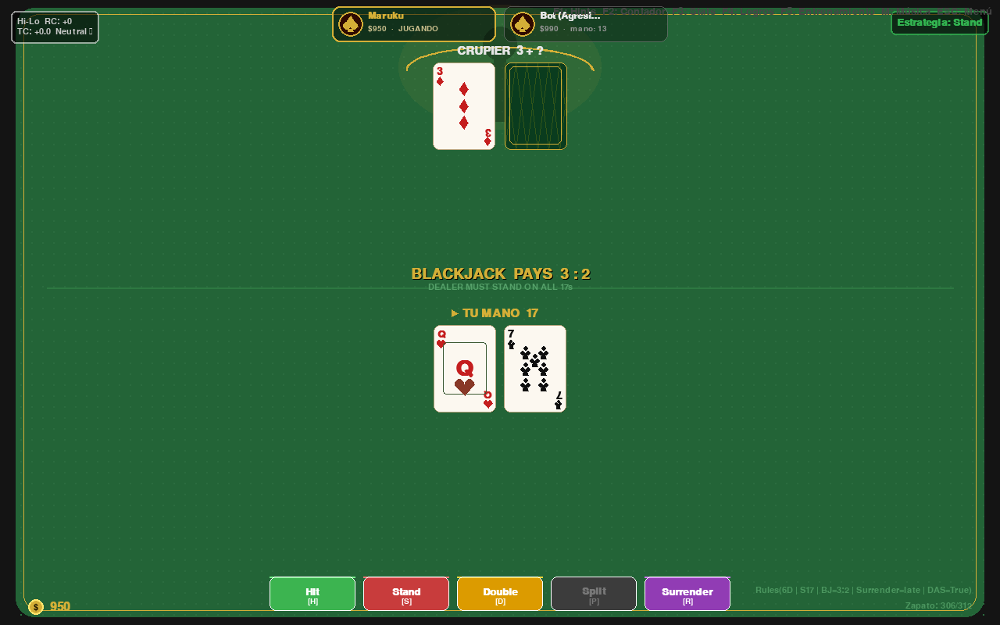
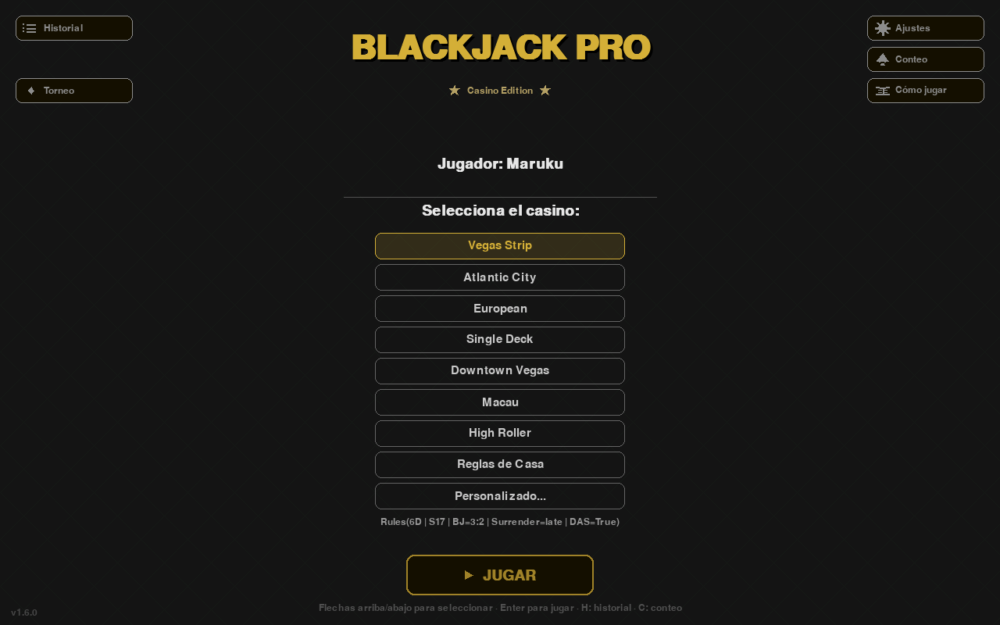
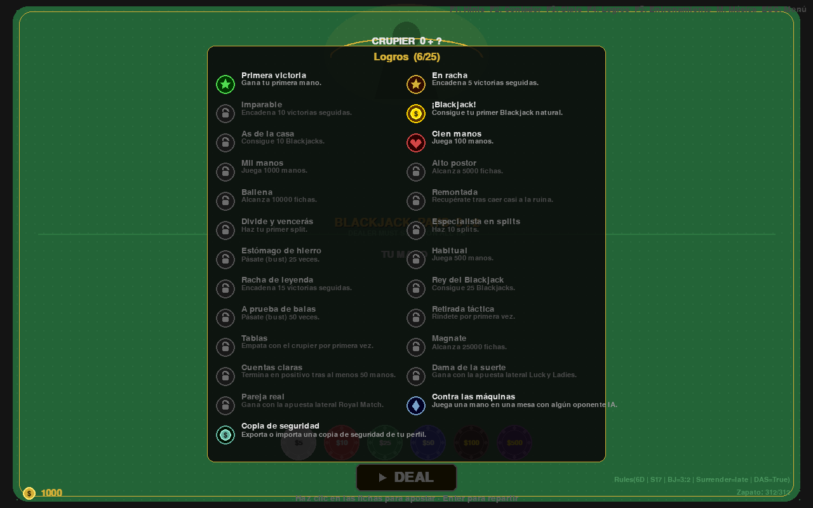
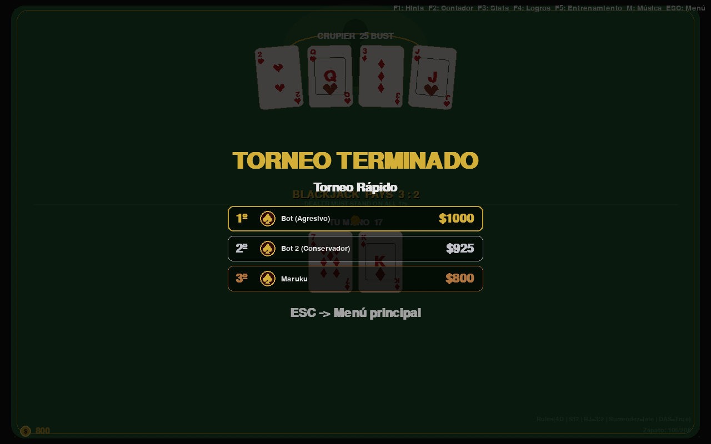

# 🃏 Blackjack Pro

Juego de Blackjack profesional con gráficos 2D en Python + Pygame. Todos los
gráficos, animaciones y sonidos son procedurales (generados por código, sin
archivos de imagen ni audio), así que el proyecto entero cabe en unos pocos
megabytes de código puro.

## Capturas de pantalla

| | |
|---|---|
|  |  |
|  |  |

## Características

**Reglas y mesa**
- 8 presets de casino (Vegas Strip, Atlantic City, European, Single Deck,
  Downtown Vegas, Macau, High Roller, Reglas de Casa) y un editor de reglas
  personalizadas (17 parámetros: número de mazos, penetración, pagos de
  Blackjack, doblar tras split, resplit, seguro, rendición, etc.)
- Soporte para 1, 2, 4, 6 y 8 mazos
- Todas las acciones: Hit, Stand, Double Down, Split (con resplit), Surrender,
  Insurance / Even Money
- 4 apuestas laterales opcionales: Perfect Pairs, 21+3, Lucky Ladies y Royal
  Match
- Multijugador local por turnos ("hot-seat"), de 1 a 3 jugadores en la misma
  mesa, con avatares e historial independiente por asiento

**Oponentes IA y modos de juego**
- Bots: asientos controlados por IA que juegan con la estrategia básica
  (`ai/basic_strategy.py`), en una de tres "personalidades" -- Perfecto
  (estrategia básica pura), Conservador (nunca dobla ni separa) o Agresivo
  (dobla y separa más de la cuenta) -- elegibles al sentarlos a la mesa
- Modo Desafío: 4 partidas cortas con un objetivo concreto (llegar a una
  cifra de fichas, sobrevivir X manos, una racha sin fallos, terminar en
  positivo) y su propio límite de manos/fichas iniciales
- Modo Torneo: 3 partidas a mesa completa (humanos + bots) con las mismas
  fichas para todos los asientos y un número fijo de manos -- al terminar, una
  clasificación final por fichas decide quién gana

**Ayudas y estadísticas**
- Modo entrenamiento (F5): compara cada jugada contra la estrategia básica en
  vivo, con marcador de acierto
- Contador de cartas Hi-Lo visual (F2) y un modo de práctica de conteo
  independiente, con marca personal guardada por perfil
- Sugerencias de estrategia básica (F1) y panel de estadísticas de sesión (F3)
- Perfiles de jugador locales (sin contraseña) con historial de manos
  persistente, copia de seguridad exportable/importable en JSON, comparativa/
  leaderboard entre perfiles, gráfica de evolución de fichas y repetición
  visual de cualquier mano jugada
- Exportación del historial de manos y las estadísticas a CSV
- 25 logros desbloqueables (F4), incluidos los ligados a apuestas laterales,
  jugar contra un bot o hacer una copia de seguridad del perfil
- Pantalla de tutorial / "Cómo jugar" con el objetivo del juego, el flujo de
  una ronda, las acciones disponibles y las apuestas laterales

**Idiomas, accesibilidad y presentación**
- 5 idiomas (español, inglés, francés, portugués, alemán), seleccionables en
  caliente desde "Ajustes" -- toda la interfaz se traduce al instante, sin
  reiniciar la partida
- Tamaño de letra grande y modo de alto contraste, también desde "Ajustes",
  aplicados al instante y persistentes entre partidas
- Animaciones de cartas, fichas y efectos de partículas; audio ambiente y
  efectos de sonido, todo generado por código (M silencia/activa la música)
- 6 temas visuales de mesa y 5 reversos de carta intercambiables, más control
  de volumen, todo desde "Ajustes" y persistente entre partidas

## Instalación

### Opción 1 — Instalador de Windows (recomendado para jugar)

Descarga o genera `BlackjackPro_Setup.exe` (ver "Generar el instalador" más
abajo) y ejecútalo. No hace falta tener Python instalado ni permisos de
administrador. Crea acceso directo en el menú inicio (y, si lo marcas, en el
escritorio) junto con su propio desinstalador. Las partidas guardadas viven
en su propia carpeta `saves`, separada del programa, así que desinstalar
nunca las borra.

### Opción 2 — Desde el código fuente (para jugar en otros sistemas o para desarrollo)

```bash
python -m venv .venv
source .venv/bin/activate      # macOS/Linux
# .venv\Scripts\activate       # Windows

pip install -r requirements.txt
python main.py                 # interfaz gráfica (Pygame)
python main.py console         # modo consola interactivo
```

## Generar el .exe / el instalador (solo Windows)

```
build_exe.bat         → genera dist\BlackjackPro.exe (PyInstaller, un solo archivo)
build_installer.bat   → genera dist_installer\BlackjackPro_Setup.exe (requiere Inno Setup,
                         gratis en https://jrsoftware.org/isdl.php — el script lo detecta solo)
```

`build_installer.bat` genera primero el `.exe` si no existe, así que basta con
correr ese script directamente.

## Estructura del proyecto

```
blackjack_pro/
├── core/       # Lógica pura: cartas, mazos, manos, jugadores, reglas
├── engine/     # Motor de partida: estados, acciones, pagos, estadísticas,
│               # perfiles/SQLite, historial de manos, logros, desafíos,
│               # torneos, ajustes
├── ai/         # Estrategia básica (+ personalidades de bot) y contador de
│               # cartas Hi-Lo
├── ui/         # Gráficos Pygame: mesa, sprites, HUD, animaciones, menú,
│               # perfiles, historial, comparativa, ajustes, repetición de
│               # mano, selección de Desafío/Torneo, tutorial
├── config/     # Configuración, presets de reglas, temas visuales e idiomas
├── assets/     # Icono de la app y capturas de pantalla -- el resto de
│               # gráficos y sonidos del juego en sí son procedurales, no
│               # hay imágenes ni audio de juego en disco
├── saves/      # Base de datos SQLite con perfiles, fichas e historial
│               # (se crea sola al arrancar; nunca se toca al instalar/desinstalar)
├── tests/      # Tests unitarios de la lógica base (mazos, manos, pagos, motor)
├── main.py             # Punto de entrada (gráfico o consola)
├── build_exe.bat       # Genera el .exe con PyInstaller
├── build_installer.bat # Genera el instalador con Inno Setup
└── installer.iss       # Script de Inno Setup
```

## Tests

```bash
python -m pytest tests/ -v
```

Más de 200 tests automatizados con `pytest`, cubriendo el motor de partida,
las apuestas laterales, los logros, los Desafíos y Torneos, las
personalidades de bot, el sistema de 5 idiomas, la exportación CSV y el
contador Hi-Lo. El resto de funcionalidades puramente visuales (animaciones,
temas, instalador...) se ha ido verificando con baterías de pruebas propias
-- incluidas simulaciones headless de partidas completas que detectan si
algún asiento se queda "atascado" esperando una acción inválida -- en cada
fase de desarrollo antes de cada entrega.

## Controles rápidos

| Tecla | Acción |
|---|---|
| F1 | Mostrar/ocultar sugerencia de estrategia básica |
| F2 | Mostrar/ocultar contador de cartas Hi-Lo |
| F3 | Panel de estadísticas de sesión |
| F4 | Panel de logros |
| F5 | Modo entrenamiento (compara tus jugadas con la estrategia básica) |
| H | Historial de manos (desde el menú principal) |
| M | Silenciar/activar la música |
| Esc | Volver al menú |
